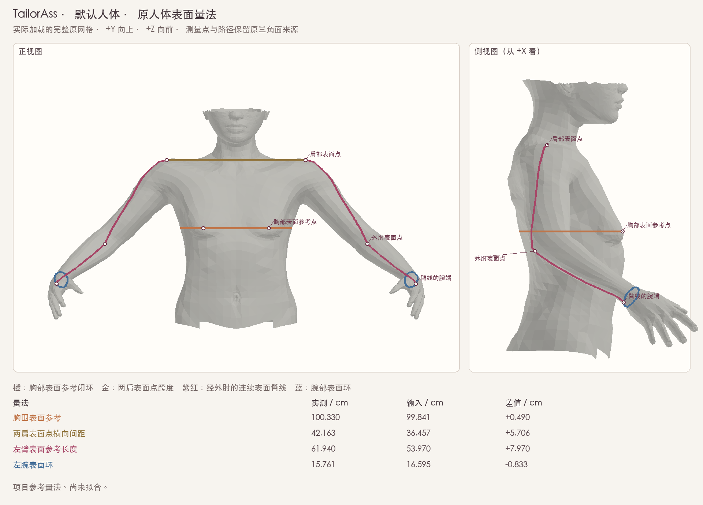
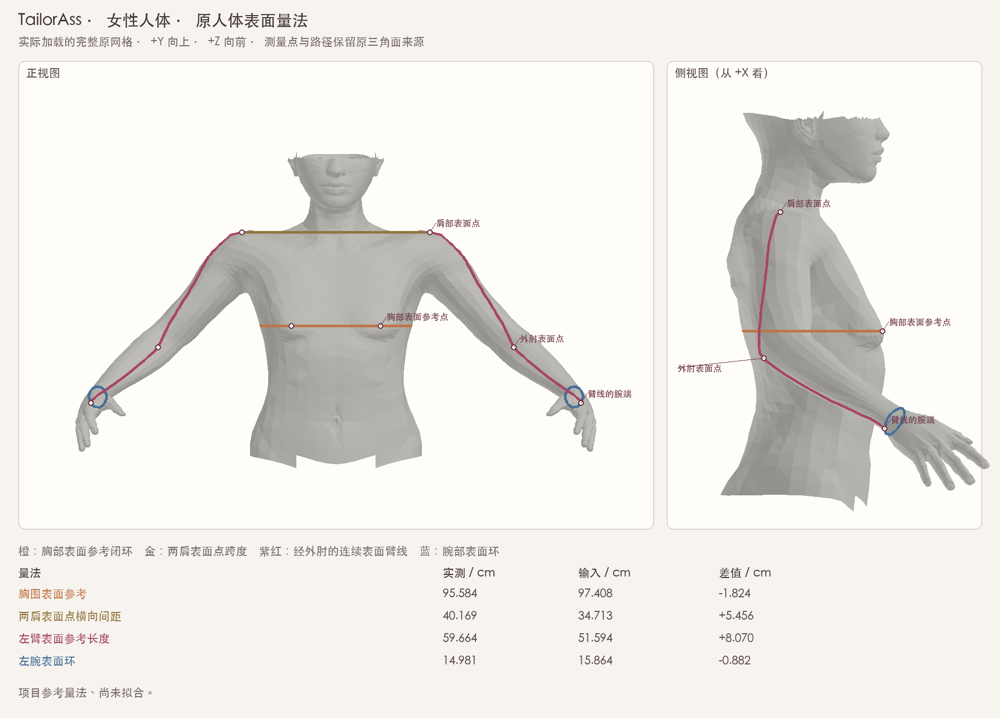

# 人体表面参考量法

本模块把胸围、肩宽、臂长、腕围变成可重算、可追溯到原人体表面的量。当前只测量并报告输入差值；没有应用拟合，也没有更改原 StandardBody、显示/碰撞网格或默认参数。





## 源与契约

新增 `TrailorAss/Models/GarmentCodeBodySurfaceMeasurements.swift` 与 `TrailorAss/Resources/GarmentCodeBodySurfaceMeasurements.json`。资源 SHA256 为 `6658a5ed298c82f36c0b1bce6df0823a10c0f0bb5aa67c136c142cb6bc5ce610`；运行时同时绑定原人体 JSON 与 rig JSON 的完整文件 SHA、13380 个可见顶点映射、26756 个原三角面及 MakeHuman 源提交。

源为 MakeHuman 提交 `a8bc2d54ff0ac92e78ff71431b1023eda42bf482` 的 CC0 数据。作者工具只读取这四份固定数据及项目已有模板/rig/provenance，不扫描量体插件，也不引入第三方量体路径或索引：

- [base.obj](https://github.com/makehumancommunity/makehuman/blob/a8bc2d54ff0ac92e78ff71431b1023eda42bf482/makehuman/data/3dobjs/base.obj)，SHA `8e761e6624b8f54536409135d1636da63b32486a90d4897f84e121d144f6fb4c`。
- [default.mhskel](https://github.com/makehumancommunity/makehuman/blob/a8bc2d54ff0ac92e78ff71431b1023eda42bf482/makehuman/data/rigs/default.mhskel)，SHA `7131071b0c48c07d03a80a58aaefb4e0a2f9f5aaecddc536742d1ddb91754a4d`。
- [default_weights.mhw](https://github.com/makehumancommunity/makehuman/blob/a8bc2d54ff0ac92e78ff71431b1023eda42bf482/makehuman/data/rigs/default_weights.mhw)，SHA `0f3641d651ae3d00ad6b4ccee43142edb109d3bd909d27d9e4139ef1beed8625`。
- [LICENSE.ASSETS.md](https://github.com/makehumancommunity/makehuman/blob/a8bc2d54ff0ac92e78ff71431b1023eda42bf482/LICENSE.ASSETS.md)，SHA `f6089cba01cb570a24712b41ab8a586ccd3cc5ef53dc266ca50b95c288956d2c`。

量法由本项目自行定义。骨架只在一次性标注时定位搜索区域；最终每个点均是实际可见皮肤的源顶点或三角面重心附着，运行时不读取骨长或骨锚。所有表面路径段都记录原面编号，两个端点都由该面的顶点构成；没有使用跨空中的弦来代替表面段。

## 四类量法

| 量 | 可执行定义 | 与衣服参数的联系 |
| --- | --- | --- |
| 胸围表面参考 | 源可见顶点 8451、1779 的平均高度处作水平截面；选择严格包含声明躯干轴、且在指定躯干区域内的唯一环 | 与 `bust` 作项目参考比较；这是指定参考高度，尚未自动寻找最丰满胸围 |
| 肩横宽 | 由原肩区内部种子向 +Y 射线得到左右实际皮肤点；取两点的 +X 横向间距 | 与 `shoulder_w` 比较；另保留两点三维直线跨度，标为仅参考 |
| 左右臂长 | 肩表面点 → 外肘表面点 → 腕环上的外侧端点，在连续原三角带内的表面折线长度 | 与 `arm_length` 作本项目参考比较；不是骨段长度，未宣称全局最短测地线 |
| 左右腕围 | 在原腕区作前臂轴法平面截线，选含腕种子的唯一环；保存实际表面附着 | 与 `wrist` 作本项目参考比较；后续变形后仍跟随同一皮肤路径，可能不再共面 |

胸截面实际有 **3 个环**，腕截面有 **5 个环**，所有环及选择依据保存在 `Fixtures/body-surface-reference/authoring-trace.json`。选择器使用声明轴的包含关系与区域约束；没有选最大环、相加所有环或求凸包。腕部选中的环长 15.761cm，而同平面另有 49.239cm 的环，也可直接反证“最大环”等价于腕围的假设。

GarmentCode 的 [bodice.py](https://github.com/maria-korosteleva/GarmentCode/blob/d449629979028123a5c4dc9e732a2ec19b7fce31/assets/garment_programs/bodice.py) 将 `shoulder_w / 2` 当横向半宽；[body_params.py](https://github.com/maria-korosteleva/GarmentCode/blob/d449629979028123a5c4dc9e732a2ec19b7fce31/assets/bodies/body_params.py) 另派生 `_base_sleeve_balance = shoulder_w - 2`。因此拟合参考采用横向宽，不把背部表面弧长直接塞入 `shoulder_w`。当前对称参考姿势里横向宽与三维跨度相等；换姿势后两者可能不同。[sleeves.py](https://github.com/maria-korosteleva/GarmentCode/blob/d449629979028123a5c4dc9e732a2ec19b7fce31/assets/garment_programs/sleeves.py) 消费 `arm_length` 生成袖长，但未在该文件中定义皮肤量法；本项目臂线路径仍需后续量体验证，不能把当前表面值与输入差值当作已通过人体拟合。

## 臂线改进的实际依据

初版沿源网格边走，肩→外肘→腕长 **68.614458cm**，肘附近可见绕路。新版在相邻原三角面带内优化共享边上的点，左右各 **72 点、71 原面**，分别为 **61.939694851cm / 61.939694855cm**。肩→外肘→腕两条空间弦的总长 **60.437274cm** 只作为下界，没有作为测量结果。

作者工具比较固定三角带的几种确定性搜索方案，用 L-BFGS-B 优化面内折线总长并用逐级光滑范数处理零长度门户；最终选择依据是未光滑的实际表面长度，不使用目标臂长来挑选路线。原边走线、各候选三角带、门户、迭代记录及优化前后长度全部保留。它解决了已观察到的折返，不宣称证明了整个皮肤上的全局最短路径。

## 当前真实测量与残差

数据来自生产 `GarmentCodeStandardBody.load` 的两个人体，单位 cm；残差 = 表面实测 − 输入。左右腕基本相同；下表臂/腕展示左侧，完整七项含左右侧与两种肩跨度见 `Fixtures/body-surface-reference/reference-values.json`。

| 人体 | 量 | 表面实测 | 输入 | 残差 |
| --- | --- | ---: | ---: | ---: |
| 默认 | 胸围参考 | 100.3303 | 99.8407 | +0.4896 |
| 默认 | 肩横宽 | 42.1633 | 36.4568 | +5.7065 |
| 默认 | 臂表面长度 | 61.9397 | 53.9697 | +7.9700 |
| 默认 | 腕表面环 | 15.7613 | 16.5945 | −0.8332 |
| 女性 | 胸围参考 | 95.5840 | 97.4076 | −1.8236 |
| 女性 | 肩横宽 | 40.1686 | 34.7129 | +5.4557 |
| 女性 | 臂表面长度 | 59.6639 | 51.5940 | +8.0699 |
| 女性 | 腕表面环 | 14.9814 | 15.8636 | −0.8822 |

这些结果说明现有粗略人体缩放没有分别拟合这四类表面量。测量器如实保留差值，不通过修改目标、移动量体点或改写结果来制造拟合通过。

## 复现与验证范围

在项目根运行：

```sh
python3 Tests/NativePattern/run-body-surface-measurements.py --render
```

Swift 编译采用 `-O -swift-version 5 -default-isolation MainActor -strict-concurrency=complete -warnings-as-errors`。还对相同十个生产模型执行 iOS 17 `arm64-apple-ios17.0` 与 `arm64-apple-ios17.0-simulator` 严格 typecheck。当前安装 SDK 为 Xcode iPhoneOS/iPhoneSimulator 27.0；部署目标为 17.0。没有编译/链接 Native 包、安装 App 或声称已在 iPhone 启动。

验证实际加载 default/female，完整保留 33 项原始/派生值，核验原拓扑、所有附着、非退化面、输入/源文件 SHA、取消、预算与错误输入。改变输入目标但不改网格时，实测值逐位不变；实际网格缩放/平移时，表面量按真实几何变化。独立 Python 使用 `math.fsum` / `math.dist` 复算四份实际网格数据共 **1560 原面段**，并以 Fraction 核验归一化非负重心支持、计算实际浮点附着到精确面内点的距离界；长度比较容差为 **2e−12m**。完整的当前人体顶点/三角面与几何/全参数 SHA 同时输出，不借用 Swift 自报长度作为独立值。

`--render` 需要 Pillow；中文图使用 macOS 的 STHeiti 字体。一次性重新标注另需 NumPy 1.26.4 / SciPy 1.13.1 与上面四份固定源文件：

```sh
python3 Tests/NativePattern/PrepareBodySurfaceMeasurements.py \
  --source-dir /path/to/pinned-cc0-assets \
  --template TrailorAss/Resources/GarmentCodeStandardBody.json \
  --rig TrailorAss/Resources/GarmentCodeStandardBodyRig/rig.json \
  --rig-provenance TrailorAss/Resources/GarmentCodeStandardBodyRig/provenance.json \
  --python-packages /path/to/numpy126-scipy113 \
  --output /new/authoring-directory
```

已验证 Python 3.12.14。原 rig 曾用旧版 Python 求和，3.12 的 `sum()` 改进会使不相关权重/元数据末位不同；作者工具不会重写旧 rig，而是要求可见几何、源映射、原 joint 源表完全相同，并以显式原顺序求和核对定位种子。失败的首次过严全文件断言与修正记录均保留在冻结交付中。

Xcode 项目 `TrailorAss` 是目标 `TrailorAss` 的 `PBXFileSystemSynchronizedRootGroup`，没有新文件的 membership 排除；新增 `.swift` 与根 Resources 下的 JSON 都处于自动同步范围。本轮只检查该构建规则与文件存在/哈希，不触发整个 App 构建；实际新资源入 `.app` 的检查随下一次完整 App 构建完成。

后续拟合必须在声明的参考姿势上优化并重测这些表面量，绑定新的完整几何与参数；只有量差、原拓扑和完整人体几何检查都通过后，才可给其他模块提供拟合后的显示/碰撞网格。当前没有把该测量报告升级为拟合人体凭证。
